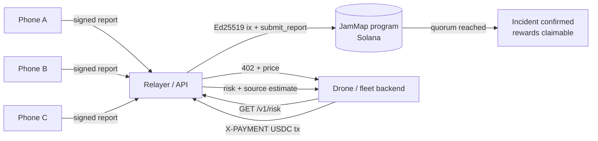

<p align="center"></p>

# JamMap

**Phones that hear GPS attacks. Solana that proves them.**

GPS jamming and spoofing are no longer a war-zone curiosity. IATA reports jamming up 67% and spoofing up 193% between 2023 and 2025, and spoofing hit up to ~1,500 flights a day in 2024. Aircraft-based maps only see the sky above airways. On the ground, where drones fly, trucks route and tractors steer by GPS, almost nobody measures it.

JamMap turns ordinary Android phones into a passive interference-sensing network:

1. **Detect.** The app reads raw GNSS measurements (per-satellite C/N0 and receiver AGC) through the Android API and classifies every second as clean, *jamming*, *spoofing* or *obstruction*. AGC is the key: a jammer pushes AGC **down**, a phone in a pocket or a metal box pushes it **up**. JamMap reports the first and ignores the second.
2. **Prove.** The phone signs a 34-byte report with its own ed25519 key. A relayer pays the fees, but the Solana program verifies the *phone's* signature through the native Ed25519 program and the instructions sysvar, so the relayer can't forge or alter reports. An incident (zone × 5-minute window) is **confirmed only when 3 distinct registered devices** report it. One device can vote once per incident.
3. **Reward.** Every reporter of a confirmed incident can claim JAM tokens from an on-chain vault.
4. **Sell.** Drone operators, fleet software and insurers buy precise data (source estimate, severity, risk score) **per request via x402**: HTTP 402 → USDC payment on Solana → data. No account, no API key, built for machines.

> JamMap only listens. It never transmits. Operating a GNSS jammer is illegal almost everywhere, and the demo never uses one.

## What's in this repo

| Path | What it is |
|---|---|
| `programs/jammap` | Anchor program: device registry, Ed25519-verified reports, quorum consensus, reward vault |
| `tests/jammap.ts` | Anchor tests: quorum, duplicate votes, forged signer, tampered fields, single claim |
| `server/` | Relayer + data API (Node, no framework): signature checks, feature re-validation, x402 paywall, source localization |
| `server/src/sim.js` | Virtual phone fleet running the same detector on synthetic GNSS: jammer, spoofer, a phone in a metal box, a rogue reporter |
| `server/src/buyer.js` | x402 client: what a drone operator's backend runs to buy data |
| `web/` | Live dashboard: zones, phones, incidents, feed, in-browser x402 purchase |
| `android/` | Kotlin app: raw GNSS → detector → signed reports (no SOL on the phone) |

## Architecture



**Trust model.** The phone's key signs `domain ‖ zone ‖ timestamp ‖ kind ‖ severity`. The program checks the preceding Ed25519 instruction carries exactly that message from exactly the registered device key, with all data inline. The relayer also re-runs the detector on the measurements the phone sends and rejects reports whose numbers don't support the claim. Positions are kept to ~5 km zones on-chain; precise points stay off-chain.

**Known limits (MVP).** Sybil resistance is quorum-only. Next: Play Integrity / Keystore attestation and stake-weighted devices. Not every phone exposes AGC; those phones don't report. Localization is a weighted centroid; a path-loss fit is next.

## Run it (5 minutes, no blockchain needed)

```bash
cd server
npm install
npm run demo        # relayer + dashboard on http://localhost:8787 (demo payments on)
npm run sim         # in a second terminal: 17 virtual phones play the scenario
node src/buyer.js --demo --lat 42.32 --lon 69.62   # buy data through x402 (demo payment)
npm test            # detector + wire-format tests
```

## Run it on Solana devnet

```bash
anchor build && anchor keys sync && anchor build
anchor test                                  # local validator
anchor deploy --provider.cluster devnet
cd server && JAMMAP_PROGRAM_ID=<id> npm run setup:devnet   # relayer keys, JAM mint, config, vault
# put JAMMAP_PROGRAM_ID and RELAYER_KEYPAIR in server/.env, then:
npm run demo && npm run sim
npm run buy -- --lat 42.32 --lon 69.62       # real USDC (devnet) x402 payment
```

## Android

Open `android/` in Android Studio, run on a phone with Android 8+ (AGC needs a recent chipset; Pixel 5+ / Galaxy S21+ are good bets). Enter the relayer URL (`http://<laptop-LAN-IP>:8787`) and a reward wallet, tap **Register**, then **Start listening**. The **TEST** switch injects a synthetic jammer signature into real measurements, so you can show the whole pipeline without any radio.

## Why Solana

Thousands of phones × reports every few minutes require sub-cent fees. Native Ed25519 verification lets phones without SOL or wallets sign data the chain can check. USDC + x402 make machine-to-machine data sales one HTTP round trip.

## License

MIT
